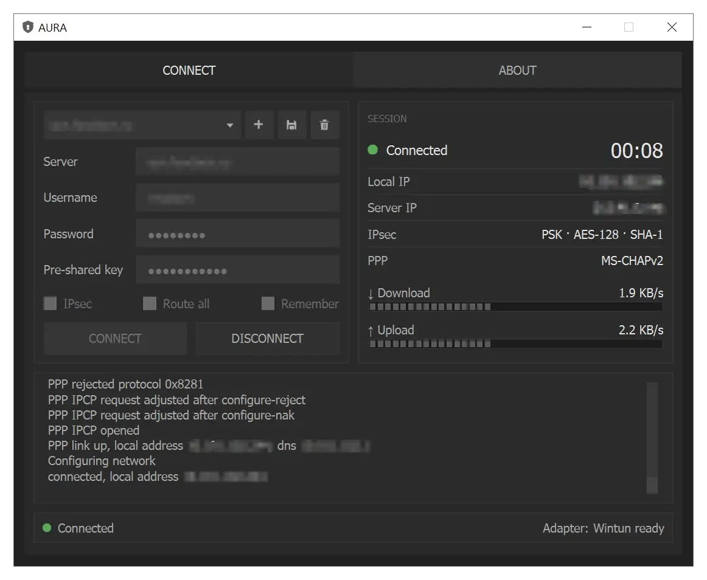
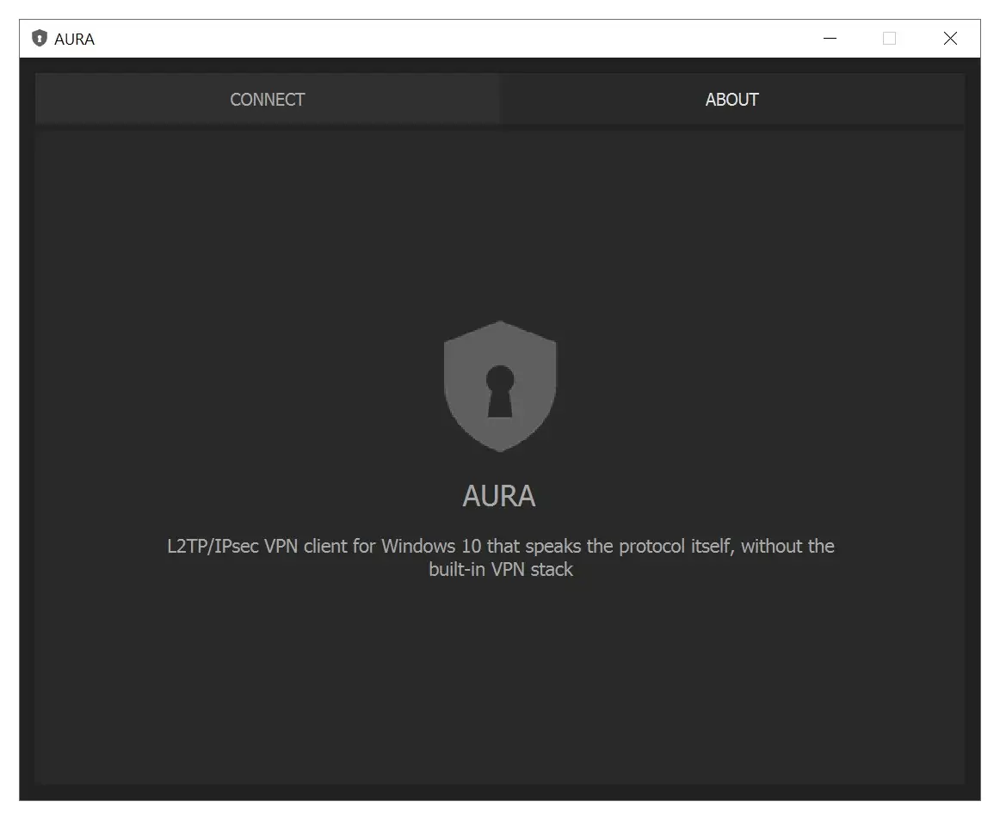

# AURA

[](./LICENSE)
[](https://github.com/m-o-z-z-i-x/AURA/releases)


Windows 10 L2TP/IPsec VPN client that speaks the protocol itself — its own IKEv1, ESP, L2TP and PPP stack, a Wintun virtual adapter for the traffic. Pure Python on top of the Wintun driver from the WireGuard project, no use of the built-in Windows VPN

> [!IMPORTANT]
>
> **Privacy First:** Your credentials stay **on your machine** — a password and a pre-shared key are
> written to disk only when you tick Remember, and then only as a DPAPI blob that opens for your Windows
> account alone. Traffic and credentials go to exactly one place, the server you configure — no
> telemetry, no analytics, no update checks, and passwords or keys never reach the log

> [!NOTE]
>
> AURA needs **administrator rights at launch**. A Wintun adapter, routes and DNS are system changes, so
> Windows asks for them once through UAC — and if the prompt is declined, the program does not start.
> Nothing of Windows' built-in VPN client is used: no RAS connection, no `rasdial`, no Windows VPN
> service involved

## 🖥️ Demo

<p align="center">
  
  
</p>

---

## 🚀 Key Features

- **🔐 Own IKEv1/IPsec Stack** - Main and quick mode with a pre-shared key, NAT traversal and dead peer detection. Offers 18 proposals (AES/3DES, SHA-256/SHA-1, DH 14/5/2) and uses whichever the server picks
- **🧵 L2TP + PPP** - One tunnel and session with keepalive, then MS-CHAPv2 / CHAP / PAP (whatever the server asks for), IPCP for the address and DNS, and MPPE where a server demands it
- **🛡️ Wintun Virtual Adapter** - Traffic goes through a real Wintun adapter named AURA. Route all sends everything through the tunnel, or list your own networks in `extraRoutes`
- **🗂️ Connection Profiles** - Several saved servers in a combo box. Password and pre-shared key are kept only on request, protected with DPAPI
- **🧹 Crash Recovery Sweep** - Every route, DNS entry and the adapter are recorded before they change, and the next launch removes whatever a crash left behind

---

## 🛠️ Using

Enter a server (host name or IPv4 address), a username, a password and, when the server wants one, a
pre-shared key, then press CONNECT.

- **CONNECT / DISCONNECT** - Starts the tunnel, or ends it and cancels an attempt in progress. The status bar and the log panel walk through the stages. Routes, DNS and the adapter are removed in reverse order, also when the window is closed
- **Profile row** - Pick, create (new), save (**Ctrl+S**) and delete profiles. A new profile is named after its server on the first save, and switching away from an edited one asks whether to save it
- **Checkboxes** - **IPsec** (off: plain L2TP on UDP 1701, no pre-shared key), **Route all** (off: only the profile's `extraRoutes` go through the tunnel) and **Remember** (save the password and the pre-shared key, DPAPI-protected)
- **Session panel** - Dimmed until a tunnel is up, then the status, uptime, your address inside the tunnel, the server, the IPsec transform, the PPP authentication and the download/upload speed
- **Status bar & log panel** - The state, the adapter ("Wintun ready" or "wintun.dll missing") and the protocol events, the same lines that go to `logs/execution-report.log`. Passwords and keys are never in it

A failed attempt shows the cause in the status bar, and the field to blame turns red: a wrong pre-shared key
marks the key, a rejected login marks the username and the password. There is no automatic reconnect — press
CONNECT again.

> [!TIP]
>
> If the server wants an IPsec ID or a group name, set `ikeId` in the profile (see below). Without it
> AURA identifies itself by its IPv4 address, which is what most pre-shared-key servers expect

---

## ⚙️ Configuration

Settings live in `profiles.json`, next to `main.py` (next to `AURA.exe` in the built one). Everything else is
fixed in code. The window edits the first rows, and the advanced keys are changed by hand while the program is
closed. A key of the wrong type falls back to its default, an out-of-range value is refused with a message:

| Key | Default | Meaning |
|---|---|---|
| `name`, `server`, `username` | empty | what the form shows |
| `ipsecEnabled`, `routeAll`, `remember` | `true`, `true`, `false` | the three checkboxes |
| `passwordProtected`, `pskProtected` | — | the password and the key as DPAPI blobs, written only when `remember` is on |
| `port` | `1701` | the server's L2TP port without IPsec, 1 to 65535 |
| `ikePort` | `500` | the server's IKE port, 1 to 65535 |
| `mtu` | `1400` | adapter MTU, 576 to 1400 |
| `authMethods` | `["mschapv2", "chap", "pap"]` | the PPP methods AURA accepts, in preference order |
| `mppe` | `"auto"` | `"auto"`, `"required"` or `"off"`. MPPE is never asked for while IPsec is on |
| `dns` | `[]` | DNS servers for the adapter. Empty takes the ones the server hands out |
| `extraRoutes` | `[]` | IPv4 networks in CIDR form routed through the tunnel, with or without Route all |
| `dpdInterval` | `20.0` | seconds between dead-peer checks. `0` switches them off |
| `helloInterval` | `60.0` | seconds between L2TP keepalives |
| `ikeId` | `""` | IPsec identity as a key ID. Empty identifies by the local IPv4 address |
| `innerChecksum` | `"zero"` | `"zero"` sends the inner UDP checksum as zero (allowed by RFC 3948). `"auto"` computes it. Zero is the one value proven against a real server, so it is the default |

`settings.json` only remembers the last selected profile, and `recovery.json` is the record the crash
sweep reads — neither is meant to be edited

---

## 🔨 Develop

### 🔧 Requirements

- **Windows 10 x64.** The bundled `wintun.dll` is the amd64 build
- **Administrator rights** — for the adapter, the routes and DNS. The program asks for them itself
- Python 3.11+
- Essential packages
  ```bash
  PyQt5 pycryptodome PyQt5Designer Nuitka zstandard
  ```

### ⚡️ Quick Setup Guide

- **Clone & Open Project**
  ```bash
  git clone https://github.com/m-o-z-z-i-x/AURA.git
  cd AURA
  code .
  ```
- **Set Up Virtual Environment**
  - In VS Code
    - Open terminal (`Ctrl+~`/`Ctrl+Shift+~`)
    - Run
      ```bash
      python -m venv .venv
      ```
  - **Restart VS Code terminal** to auto-activate `.venv`
- **Install Dependencies**
  ```bash
  pip install -r requirements.txt
  ```
- **Run**
  ```bash
  python main.py
  ```

### 🎨 GUI

  - Open `gui.ui` file in `Designer`
    ```bash
    .venv/Scripts/designer.exe
    ```

> [!TIP]
>
> Create shortcut to `designer.exe` and place it in `ui/` folder for quick access

---

## 🌟 Future Roadmap

**Done**
- [x] **IKEv1 with NAT-T and DPD** - Pre-shared key main mode and quick mode, ESP in UDP/4500
- [x] **L2TP + PPP** - MS-CHAPv2, CHAP, PAP, IPCP address and DNS, MPPE
- [x] **Wintun Adapter** - Route all or custom routes, DNS from the server
- [x] **Connection Profiles** - Secrets protected with DPAPI
- [x] **Crash Recovery** - A record of every system change, swept at the next start
- [x] **Readable Errors** - Plain causes in the status bar, the offending field marked

**Planned improvements**
- [ ] **In-place IPsec Rekey** - Renew the security association before it expires. Today the session ends when the server drops it (servers answer with lifetimes of hours)
- [ ] **IKEv2** - A second protocol next to IKEv1
- [ ] **Certificates** - Authentication beyond the pre-shared key
- [ ] **IPv6** - Addresses and routes inside the tunnel
- [ ] **Tray Icon** - Live in the notification area
- [ ] **Automatic Reconnect** - Come back after a lost link
- [ ] **Kill Switch** - No traffic outside the tunnel while it is meant to be up
- [ ] **L2TP Tunnel Secret** - Servers that authenticate the tunnel itself with a shared secret are refused today

*Suggestions?* [Open an Issue](https://github.com/m-o-z-z-i-x/AURA/issues/new) to discuss new features!

---

## 🤝 Contribution

Contributions are welcome! Here's how to help improve the project

- **Fork the repository**
- **Create a feature branch**
  ```bash
  git checkout -b feature/your-feature-name
  ```
- **Commit your changes**
  ```bash
  git commit -m "Add: your feature description"
  ```
- **Push to your fork**
  ```bash
  git push origin feature/your-feature-name
  ```
- **Open a Pull Request** to the main branch of this repository

---

## 🔗 Acknowledgments

This project would not be possible without these amazing open-source contributions

- **[Wintun](https://www.wintun.net)** by the WireGuard project — the layer 3 TUN driver behind the virtual adapter, bundled in `drivers/wintun/` under the Prebuilt Binaries License of WireGuard LLC (text in `drivers/wintun/LICENSE.txt`)
- **[pycryptodome](https://www.pycryptodome.org)** — AES, 3DES, DES, RC4 and MD4 for IKE, ESP, MS-CHAPv2 and MPPE
- The specifications it is built from: RFC 2409 / 2407 (IKE), 3947 / 3948 (NAT traversal), 3706 (DPD), 4303 (ESP), 2661 (L2TP), 1661 (PPP), 2759 (MS-CHAPv2), 3078 / 3079 (MPPE)

---

## 📈 Repo Activity


---

## 🙏 Support

> ⭐ **Love this project? Give it a star!**

If you find this tool helpful and want to support its development — consider buying me a coffee!

<p align="left">
  <a href="https://yoomoney.ru/to/4100118628464111" target="_blank">
    
  </a>
  <a href="https://boosty.to/m-o-z-z-i-x/donate" target="_blank">
    
  </a>
  <br><br>
  <b>BTC:</b>
  <blockquote>bc1qunr4lkes5xdanln8j5l0gm6e7x0kfw2e6z4yve</blockquote>

  <b>TON:</b>
  <blockquote>UQBZVRZFeZI4CepVq_OF5_KiQ_oo62SzmWlGvppfGuyRqUSE</blockquote>

  <b>XMR:</b>
  <blockquote>89vPf9GUBdFXmpEhFiBSiQMQbAeWZYCGDZBfr6e45zpNVUQ8cMnYFc8ct5FH3TJvftSbKTgkHzkiPB9QoYKhNhBdLeWvesC</blockquote>

  <b>USDT (TRC20):</b>
  <blockquote>TCKL4YBLAFEHFesUuGBiB85aywNE38zVSQ</blockquote>
</p>

---

## 📬 Contacts

All my contact links are available [here](https://github.com/m-o-z-z-i-x/m-o-z-z-i-x?tab=readme-ov-file#-contacts)

---

## 📝 License

This project is licensed under the [MIT License](./LICENSE)